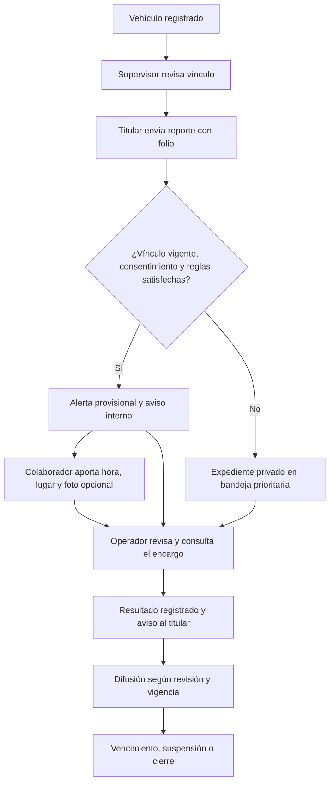

# RutaAlerta · Alertas ciudadanas provisionales

## Diagnóstico inicial

El repositorio `JORCEB/rutaalerta-avance-conectado` contiene FastAPI, PostgreSQL/PostGIS y portales ciudadano e institucional HTML/JavaScript desplegables en Vercel. El espacio de trabajo contiene además el cliente Flutter Android. La beta ya tenía correo y segundo factor, catálogo de vehículos, vínculos declarados, folio e idempotencia, publicación consentida por operador, fotos revisadas, casos por organización, avistamientos y buzón interno. La base Supabase se usa como PostgreSQL.

Faltaba una vía para revisar el vínculo antes del incidente, una publicación con vigencia breve habilitada por reglas del servidor, una comprobación de encargo separada de la denuncia declarada y un proceso explícito de suspensión. La publicación manual de la beta anterior se conserva para expedientes del formato anterior. Los reportes con declaración de sustracción entran al flujo nuevo. El repositorio carece de una integración acreditada con una API oficial de encargos, con Registro Civil y con envío push para este flujo.

## Procedimiento y reglas

1. El ciudadano autentica su cuenta, completa los controles de participación, registra el vehículo y solicita revisión a una organización. El catálogo comprueba características y formato de patente.
2. Un supervisor distinto del solicitante contrasta la identidad y el padrón con la patente. Para una cuenta de conductor autorizado contrasta además la autorización del titular. La organización conserva los antecedentes en su canal protegido y el sistema guarda un código interno, revisor, fecha, motivo y vigencia. La revisión interna se parametrizó en **365 días** para el MVP. Una discrepancia o un segundo vínculo de propietario sin resolver requiere intervención. En el cliente actual se puede registrar y solicitar revisión como titular. El servidor contempla el tipo conductor autorizado para vínculos preexistentes del modelo.
3. El reporte reutiliza el vehículo registrado. El usuario marca el lugar del hecho en el mapa o proporciona su posición desde el botón GPS cuando corresponda, especifica hora y breve descripción, declara que reporta una sustracción y decide si autoriza la difusión. Se admite foto opcional. El folio, el resultado de publicación y el siguiente paso se devuelven al guardar. La clave de idempotencia se conserva en el cliente si se reintenta el mismo envío. Un segundo expediente rápido activo de la misma cuenta para el mismo vehículo se rechaza con el folio existente.
4. La provisional requiere interruptor global, organización habilitada con integrantes activos, vínculo vigente revisado en esa organización, autorización expresa, hecho informado dentro de 24 horas, ausencia de otro expediente activo del vehículo en el entorno y un máximo de una provisional por cuenta en 24 horas. Estos límites son parámetros operativos del MVP. Las causas de exclusión se guardan en el historial institucional. Un vínculo pendiente permite guardar el caso y derivarlo a revisión prioritaria. Un vínculo rechazado o revocado pierde acceso al flujo de reporte del vehículo vinculado. El portal permite igualmente un aviso privado como testigo.
5. La provisional se guarda junto al expediente, la auditoría, el evento y los avisos internos. La difusión autenticada muestra patente, marca, modelo, color, comuna reconocida o referencia territorial aproximada, hora de ingreso y etiqueta. La ubicación visible se aproxima con grilla de 0,02°. El texto provisional lo fija el servicio. La foto y el relato aportados permanecen en el expediente hasta la revisión. El operador puede elegir una foto del titular aceptada y consentida cuando registra un resultado positivo.
6. El operador abre Auto Seguro y registra resultado, fecha, su cuenta, observación y referencia interna. Puede adjuntar una captura institucional privada. Una respuesta sin encargo describe el resultado observado en el momento consultado. La indisponibilidad se registra por separado. El servicio reutiliza el mismo modelo de resultado para manual y simulación. Una futura fuente autorizada deberá entregar resultado, fuente, instante, identificador o error y señal de simulación para incorporarse a esta misma bitácora. [Auto Seguro](https://www.autoseguro.gob.cl/)
7. El colaborador aporta hora observada, lugar y observación, con foto opcional. La hora de recepción se registra aparte. El operador ve la ubicación y foto dentro del expediente y decide con motivo. Los avistamientos y las capturas de consulta quedan fuera de la difusión.

## Estados y transiciones

| Dimensión | Cambio | Actor y condición | Resultado |
| --- | --- | --- | --- |
| Vínculo | Pendiente → autorizado o rechazado | Supervisor del receptor, distinto del solicitante, con estado esperado vigente | Revisor, fecha, motivo y referencia interna protegida |
| Vínculo | Autorizado → revocado | Supervisor del receptor con motivo y estado esperado | Pérdida de difusión de las alertas que dependen del vínculo |
| Caso | Recibido → revisión → gestión → cerrado | Operador de la organización, según permisos del expediente | Historial y avisos de estado |
| Difusión | Privada → pendiente | Titular consiente y falta una condición automática | Caso en bandeja y causa registrada |
| Difusión | Pendiente → provisional activa | Servicio al guardar un reporte que cumple las reglas | Difusión acotada y aviso interno a titular y equipo |
| Encargo | No consultado → encontrado, sin resultado o no disponible | Operador tras consulta manual, o supervisor administrador en demostración aislada | Resultado con fuente, fecha, observación y simulación |
| Difusión | Provisional activa → encargo comprobado | Operador registra resultado positivo mientras la publicación está vigente | Etiqueta actualizada con el vencimiento que ya tenía |
| Difusión | Pendiente, suspendida o vencida → publicación revisada con encargo comprobado | Operador registra consulta positiva reciente, vínculo vigente, consentimiento y motivo | Nueva solicitud fundada y expediente previo conservado |
| Difusión | Activa → suspendida | Operador con motivo, titular retira consentimiento o informa recuperación, o el vínculo deja de cumplir | Fuera de lista, detalle, foto pública y aportes nuevos |
| Difusión | Activa → vencida | Reloj del servidor. Trabajo de vencimiento registra el cambio y avisa | Expediente conserva su historial |
| Difusión | Activa → retirada o cerrada | Operador con motivo en el caso de su organización | Difusión termina y se preserva auditoría |

El informe de recuperación del titular suspende difusión y abre un antecedente para revisión. La cancelación oficial del encargo se gestiona por la vía institucional externa. Las acciones nuevas usan la revisión del expediente y bloqueo de fila. Ante una versión anterior el servicio responde HTTP 409 y la ficha se debe actualizar.

## Aplicación y operación

- **Orden para una base existente**. Comprobar que tiene las migraciones 01–08 y aplicar `09_Alertas_Provisionales.sql` con el rol de migración antes de iniciar la API 0.21. La migración agrega columnas y `consulta_encargo`, deja las instalaciones existentes con el piloto apagado y concede acceso limitado a `ra_api` si existe. El conteo esperado es 67 tablas. Para una base descartable, usar los scripts 01–09 en orden.
- Mantener `ALERTAS_AUTOMATICAS=0` y la habilitación por organización en falso durante la revisión. Después de la aprobación, configurar el interruptor y habilitar solamente organizaciones acordadas mediante su rol de administración de base. `ALERTA_MINUTOS=60` es el valor inicial de prueba, ajustable entre 10 y 180. La hora inicial de validez y el vencimiento se calculan en el servidor.
- Los clientes actualizan en primer plano cada 20 segundos. El portal mantiene la lista operativa sincronizada y permite actualizar la ficha sin sobrescribir el formulario en edición. Se eligieron solicitudes HTTP periódicas compatibles con las funciones actuales de Vercel. El buzón persiste avisos con fecha de creación y lectura. La entrega externa y el push permanecen pendientes.
- Los filtros de acceso excluyen vencidas aunque el trabajo de vencimiento esté detenido. El escritorio llama al procesamiento con su ámbito autorizado. Para generar avisos aun sin un operador conectado, programar `scripts/vencer_alertas.py` en el entorno de servicio. El comando procesa hasta 50 por ciclo y la agenda de producción requiere configuración. El auditor puede comprobar el evento y los avisos por separado.
- Retirar difusión preserva el historial. La referencia a la documentación de vínculo remite al repositorio protegido de la institución. Definir con cada entidad la custodia, plazos y supresión de su archivo externo y las capturas almacenadas en el expediente. El sistema registra referencias y restringe las capturas a las membresías autorizadas. La política de retención automática de archivos requiere acuerdo y configuración.

## Demostración aislada

En el directorio `RutaAlerta_Conectado`, instalar dependencias de `requirements.txt` y los módulos Node `@electric-sql/pglite`, `pglite-postgis` y `pglite-socket`. Ejecutar `python scripts/demostrar_alertas.py`. El script inicia dos servicios locales en 127.0.0.1, imprime los accesos efímeros y genera una foto ficticia. La base en memoria se descarta al salir con Ctrl+C. Para comprobar el recorrido desde la terminal, usar `--validar`. Los puertos se pueden ajustar con `--puerto-api` y `--puerto-bd`.

- Profesor 1 usa la cuenta titular ficticia, con ZQXT91 aprobado y ZQXT92 pendiente.
- Profesor 2 usa la cuenta colaboradora. El presentador usa el supervisor administrador de demostración.
- El escritorio de demo se identifica como **DEMOSTRACIÓN AISLADA** y registra **SIMULACIÓN** para encargo encontrado, sin resultado y fuente no disponible. Los ciudadanos no tienen acceso a esos controles. La aplicación rechaza la simulación en el entorno de operación.

### Guion de hasta siete minutos

| Tiempo | Acción |
| --- | --- |
| 0:00–0:45 | Abrir las tres sesiones y mostrar vínculo aprobado y pendiente en el escritorio. |
| 0:45–1:45 | Profesor 1 reporta ZQXT91 con hora, lugar, consentimientos y foto de prueba. Mostrar folio y siguiente paso. |
| 1:45–2:40 | Profesor 2 espera la actualización, abre la provisional y adjunta un avistamiento ficticio con hora y lugar. |
| 2:40–3:45 | Presentador abre la ficha desde la bandeja, revisa foto y ubicación y decide con motivo. |
| 3:45–4:45 | Presentador registra el resultado simulado. Muestra la separación entre encargo, alerta y vínculo. |
| 4:45–5:45 | Titular consulta la novedad del caso. El presentador muestra vencimiento y suspensión. |
| 5:45–7:00 | Registrar el caso con ZQXT92 y mostrar la revisión prioritaria. Explicar requisitos para integrar una fuente autorizada. |

### Guion de cuatro minutos

| Tiempo | Acción |
| --- | --- |
| 0:00–0:50 | Mostrar vínculo aprobado y enviar el reporte consentido con datos ficticios. |
| 0:50–1:45 | Abrir la tarjeta provisional y enviar un avistamiento con foto. |
| 1:45–2:45 | Operador revisa el aporte y registra encargo encontrado simulado. |
| 2:45–4:00 | Titular recibe la novedad. Mostrar suspensión, el vínculo pendiente y el aviso de simulación. |

## Matriz de entrega

| Función | Estado | Alcance |
| --- | --- | --- |
| Solicitud y revisión del vínculo | Implementada | Vínculo documental, referencia externa protegida, rol, vigencia, rechazo y revocación. |
| Reporte rápido y provisional | Implementada | Servidor transaccional, folio, consentimiento, regla de publicación, prioridad y reintento. |
| Difusión, avistamientos y decisión | Implementada | Visibilidad aproximada y privada por ruta, fotos tratadas, estados, suspensión. |
| Consulta manual y simulada | Implementada | Auto Seguro manual, fuente, historial, captura privada y resultados diferenciados. |
| Avisos y revisión sin operador conectado | Parcial | Buzón implementado y comando de vencimiento disponible. Agenda externa pendiente de configuración. |
| Concurrencia operativa | Parcialmente demostrada | Se comprobó petición con revisión obsoleta. Falta una prueba de carga con PostgreSQL multiusuario y el servicio objetivo. |
| Android con API 0.21 en teléfono | No demostrada | Pruebas automatizadas de cliente y compilación. Falta la prueba con cámara, GPS y permisos en dispositivo. |
| Integraciones oficiales y push | Pendiente | APIs, acuerdos, credenciales, canales externos y validación de operación. |

## Evidencia de verificación local

Se ejecutaron 172 pruebas del servicio sobre PGlite/PostGIS. Las 18 pruebas del portal pasaron. Flutter aprobó 44 pruebas, con una remota omitida. La compilación Android 0.21.0+19 se verificó con la firma de la beta. El APK se entrega como candidato de revisión y requiere una API 0.21 aislada y con HTTPS para ensayar el flujo completo en Android.

Se comprobó publicación con vínculo aprobado, ruta prioritaria con vínculo pendiente, rechazo ante cuenta bloqueada, alcance institucional, simulaciones separadas, captura institucional protegida, vencimiento previo al trabajo de procesamiento, baja por revocación, recuperación informada, retiro de consentimiento, reintento y rechazo de una decisión obsoleta. Las capturas y el ensayo de navegador se obtuvieron con datos ficticios.

Se fijaron objetivos locales de prueba de 2 segundos para recibir el folio y 25 segundos para mostrar la tarjeta sin recarga, incluido el intervalo de consulta. En un ensayo de API se midieron 69,9 ms hasta el alta y 106,1 ms hasta la primera consulta que mostró la alerta. En una ejecución de navegador la tarjeta apareció a los 18,897 segundos desde el clic. Son observaciones individuales en localhost. El rendimiento de producción requiere medición propia.

## Texto para el Capstone

RutaAlerta incorpora una alerta ciudadana provisional para acortar el tiempo entre el reporte y la colaboración cuando el usuario cuenta con un vínculo vehicular revisado. La plataforma verifica reglas de elegibilidad antes de difundir datos mínimos y entrega el expediente a la organización al mismo tiempo. La duración inicial de prueba es configurable. Los reportes sin condiciones de publicación permanecen en una bandeja prioritaria para revisión.

El supervisor revisa el padrón, la coincidencia del solicitante y la autorización del titular cuando corresponde. El operador valida las evidencias y registra la consulta manual del encargo con su fuente, fecha, resultado y observación. La alerta provisional identifica una sustracción declarada y una consulta pendiente. El resultado positivo registrado habilita la etiqueta de encargo comprobado. Un resultado sin coincidencia describe lo observado durante la consulta y requiere conservar el contexto del expediente.

El ensayo utiliza cuentas, vehículos, fotos y resultados externos ficticios en una base local separada. La persistencia del reporte, la publicación condicionada, el avistamiento, la revisión, los avisos internos y el retiro funcionan en el software. La consulta oficial automatizada requiere autorización, credenciales, un acuerdo sobre los datos y verificación de disponibilidad y límites.
